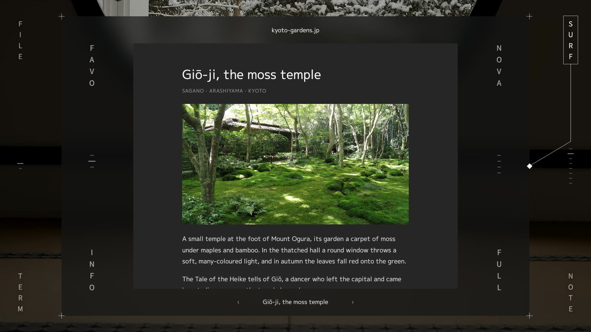
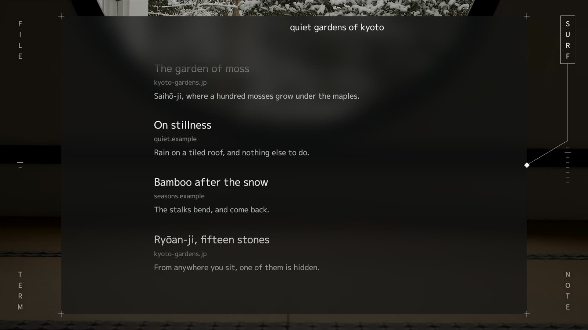

<div align="center">
  
  <h1>re: surf</h1>
  <p><em>Out into the world, like water</em></p>
  <p>A browser that stays out of the way, and lets the page be.</p>
  <p><a href="https://getrespace.app/download/ReSpace.dmg">Download for Mac</a> · <a href="https://getrespace.app">getrespace.app</a> · <a href="https://ko-fi.com/artursavytskyi">Support</a></p>
</div>

**re: surf** is a browser on the Mac's own WebKit. A search begins on a page of its own and its results come in as a quiet list that goes on as you scroll; the tabs are dashes at the window's edges. Ads are kept out, tabs left alone go to sleep, and a page can take the whole window.

<p align="center">
  <a href="https://getrespace.app">
    
  </a>
</p>

<details>
  <summary>📸 More pictures</summary>

| The results |
| --- |
|  |

</details>

## What it does

- **Quiet search**: Searching begins on a page of its own; the results come as a quiet list, more as you scroll.
- **Dash tabs**: Tabs are dashes down the edges: the ones kept on the left, the rest on the right.
- **Sleeping tabs**: Tabs left alone go to sleep, and wake when you come back.
- **Favourites**: Kept in their places, a click away.
- **No ads**: Blocked, built in: nothing to install.
- **Full page**: The page fills the window; a film fills the page.

## Part of re: space

re: surf is one of five quiet apps for the Mac. Each is fine alone; all five together make one quiet desk.

| | App | |
| :---: | :--- | :--- |
|  | [**re: desk**](https://github.com/artyr1997/ReDesk) | the desk they live on |
|  | [**re: file**](https://github.com/artyr1997/ReFile) | files, and what is in them |
|  | [**re: surf**](https://github.com/artyr1997/ReSurf) *(this one)* | a browser that stays out of the way |
|  | [**re: term**](https://github.com/artyr1997/ReTerm) | a terminal that reads like a conversation |
|  | [**re: note**](https://github.com/artyr1997/ReNote) | notes, in four quiet rooms |

## Install

Download **[ReSpace.dmg](https://getrespace.app/download/ReSpace.dmg)** from [getrespace.app](https://getrespace.app): all five apps, signed and notarized by Apple, so they open without a warning. Open it and drag each app into **Applications**.

Native Swift and AppKit. Runs on **macOS 13 Ventura or later**, on Apple silicon and Intel (one universal app).

## Keys

**Tabs and pages**

| Key | Does |
| :--- | :--- |
| ⌘N | new window |
| ⌘T | new tab |
| ⌘L | address |
| ⇧⌘W | close tab |
| ⌃⇥ | next tab |
| ⇧↑ / ⇧↓ | previous / next tab |
| ⌘[ / ⌘] | back / forward |
| ⌘R | reload |
| ⌘D | favourite |
| ⌘F | video fills the page |
| ⇧⌘F | page fills the window |
| ⌘I | info |

**Search**

| Key | Does |
| :--- | :--- |
| ← / → | previous / next page |
| ↑ / ↓, ↩ | choose, open |

With [re: desk](https://github.com/artyr1997/ReDesk) running, every key here can be set to your own in its keys sheet (⌘/).

## Build from source

With Xcode's command-line tools (Swift 5.9 or later) on macOS 13 or later:

```bash
./build.sh             # build/ReSurf.app, universal (arm64 + x86_64)
./build.sh --install   # and into Applications
```

`build/ReSurf.app/Contents/MacOS/ReSurf --render <folder>` draws its views into pictures, from made-up data.

How it is made, in detail: [docs/DETAILS.md](docs/DETAILS.md).

## Support

re: space is made by one person, slowly and with care. If it makes your days a little calmer, you can [buy me a coffee on Ko-fi](https://ko-fi.com/artursavytskyi).

## License

[MIT](LICENSE) © 2026 Artur Savytskyi. Security reports: see [SECURITY.md](SECURITY.md).
